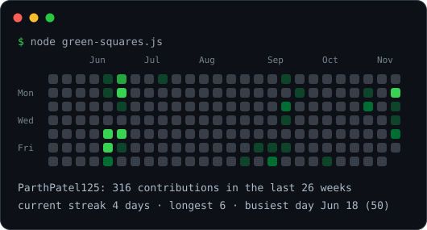

<picture>
  <source media="(prefers-color-scheme: dark)" srcset="assets/header-dark.svg">
  
</picture>

the github contribution graph, drawn right in your terminal — green squares,
month labels, streak stats and all. no api token to create, no config, no
dependencies: one file that borrows authentication from the github cli you
already have.



<picture>
  <source media="(prefers-color-scheme: dark)" srcset="assets/h-install-dark.svg">
  
</picture>

you need two things, both of which you probably have already:

- [node](https://nodejs.org) 18 or newer
- the [github cli](https://cli.github.com), logged in (`gh auth login`)

then:

```
git clone https://github.com/ParthPatel125/green-squares
cd green-squares
node green-squares.js
```

that's the whole install. the script is one file with zero npm packages, so
there is nothing to `npm install` and nothing to keep updated.

<picture>
  <source media="(prefers-color-scheme: dark)" srcset="assets/h-flags-dark.svg">
  
</picture>

by default you get your own graph, sized to fit your terminal (up to 26
weeks). everything else is a flag:

```
node green-squares.js --user torvalds   someone else's graph
node green-squares.js --weeks 40        exactly 40 weeks
node green-squares.js --year            the full 52 weeks
node green-squares.js --stats           numbers only, no graph
```

piping the output anywhere (or setting `NO_COLOR`) switches to plain
`·░▒▓█` characters, so it behaves in scripts and logs too.

<picture>
  <source media="(prefers-color-scheme: dark)" srcset="assets/h-how-it-counts-dark.svg">
  
</picture>

the data comes from github's graphql api — the same contribution calendar
that powers the graph on your profile, quartile colors included. under the
graph you get three numbers:

- **current streak** — consecutive days with at least one contribution. a
  zero *today* doesn't break it yet; you still have until midnight.
- **longest streak** — your best run in the last year, and when it ended.
- **busiest day** — the day the graph owes its brightest square to.

if your streak is in danger, [did-i-commit](https://github.com/ParthPatel125/did-i-commit)
will nag you about it. if you'd rather see the graph as glowing city lights
on your profile, that's [github-city-lights](https://github.com/ParthPatel125/github-city-lights).

---

mit licensed.
